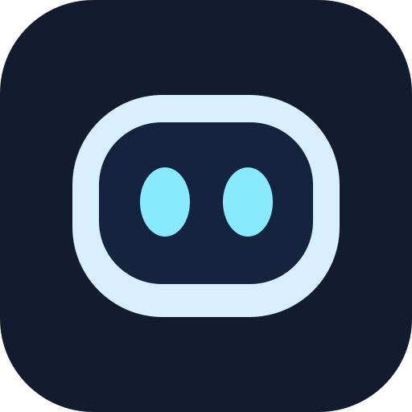

<div align="center">



# Qio / کیو

**A tiny smart companion that lives at the top of your screen — or in your Mac's notch — and keeps an eye on your AI coding agent sessions.**

**یک همراه هوشمند دسکتاپ که بالای صفحه یا در ناچ مک شما زندگی می‌کند و بر فعالیت‌های Agentهای کدنویسی نظارت می‌کند.**

<p>
  <a href="https://github.com/sahandse/Qio/releases/latest"></a>
  
  
  
  
  
  
  
</p>

[دانلود آخرین نسخه](https://github.com/sahandse/Qio/releases/latest) · [راهنمای فارسی](docs/DESKTOP_SETUP_FA.md) · [English Guide](docs/DESKTOP_SETUP_EN.md) · [گزارش مشکل](https://github.com/sahandse/Qio/issues)

</div>

---

## ✨ دربارهٔ کیو | About Qio

**کیو (Qio)** یک همراه هوشمند دسکتاپ بر پایهٔ معماری یکپارچهٔ **Tauri 2** و **Rust** است. کیو بالای صفحه‌نمایش شما (یا داخل ناچ مک) می‌نشیند و رویدادهای زندهٔ ابزارهای هوش مصنوعی و عامل‌های برنامه‌نویسی مانند **Claude Code، Cursor، Codex، Gemini CLI، Antigravity و Qoder** را نمایش می‌دهد.

بدون نیاز به ترک محیط کار یا جابه‌جایی بین پنجره‌های مختلف:
* مجوزها و درخواست‌های دسترسی ابزارها را با یک کلیک تأیید یا رد کنید (**Allow / Deny / Always**).
* پاسخ سوالات عامل‌ها (`AskUserQuestion`) را مستقیماً از بالای صفحه انتخاب کنید.
* تغییرات فایل‌ها و Diff زنده را مشاهده کنید.
* با مدل‌های هوش مصنوعی (Claude, OpenAI, Gemini, DeepSeek, Qwen, Ollama, LM Studio) گفتگو کنید.
* فایل‌ها را روی کیو بکشید (Drag & Drop) تا آن‌ها را تحلیل کند.
* کیو را روی دسکتاپ رها کنید تا به عنوان یک کاراکتر شناور و تعاملی در کنارتان باشد.

Meet **Qio**: an expressive cybernetic robot sidekick with a glowing neon visor, interactive antenna, audio badge, and 3D physics that tracks your cursor, blinks, reacts to coding agent operations, gets dizzy if poked, and jumps with joy when your tasks succeed.

---

## 🎭 امکانات کاراکتر کیو | Character Features

| ویژگی | توضیح |
|---|---|
| **انیمیشن و فیزیک سه‌بعدی** | حرکت سر، چرخش در زاویه‌های مختلف (Yaw, Pitch, Roll)، پلک‌زدن و تعقیب نرم نشانگر ماوس |
| **صفحهٔ نمایش و وایزر نئونی** | نمایشگر با تم سایبرنتیک و چشمان ال‌ای‌دی سبز نئونی و بنفش با قابلیت تغییر حالت (خوشحال، ستاره‌ای، قلبی، گیج، خواب، هشدار، خطا) |
| **آنتن واکنشی** | آنتن دارای فیزیک جهنده با گوی نورانی در رأس آن که نسبت به اتفاقات و هشدارهای سیستم واکنش نشان می‌دهد |
| **کمد لباس (Wardrobe)** | لباس‌ها و کلاه‌های متنوع (کلاه جادوگر هالووین، کلاه کریسمس، عینک آفتابی، گوش خرگوش عید و تغییر فصلی خودکار) با راست‌کلیک روی کیو |
| **کیو روی دسکتاپ** | امکان کشیدن کاراکتر از جزیرهٔ بالا به روی صفحهٔ دسکتاپ؛ همراهی آزاد، تعقیب ماوس و بازگشت خودکار هنگام رخداد هشدارها |
| **افکت‌های صوتی اختصاصی** | ۲۹ صدای منحصربه‌فرد برای باز شدن، بسته شدن، خستگی، خوابیدن، تأیید درخواست، بلعیدن فایل، خطاها و احوال‌پرسی |

---

## 🚀 امکانات اصلی برنامه | Core Capabilities

* 🤖 **نظارت بر Agentهای کدنویسی به صورت زنده:** پشتیبانی کامل از Claude Code، Cursor، Codex، Gemini CLI، Antigravity، Copilot CLI و Qoder.
* ⚡ **رلهٔ محلی بدون تاخیر (`qio-hook`):** ارتباط بر بستر Named Pipe در ویندوز و Unix Domain Socket در لینوکس و مک؛ بدون ارسال کد یا پرامپت‌ها به بیرون از سیستم.
* 💬 **چت چندمدله:** اتصال به ارائه‌دهندگان ابری (Claude، OpenAI، Gemini، DeepSeek، Qwen) با کلید اختصاصی شما یا مدل‌های کاملاً محلی (Ollama و LM Studio).
* 📁 **کشیدن و رها کردن فایل‌ها (Drop Zone):** رها کردن فایل روی کیو برای بلعیدن، ارسال یا پرسش دربارهٔ محتوای آن.
* 🔍 **نمایش زندهٔ Diff:** بازبینی تغییرات خطوط کد و نام فایل‌های تغییریافته در همان نوار بالایی.
* 📱 **لینک موبایل (Phone Link):** هماهنگی امن روی شبکهٔ Wi-Fi محلی با گوشی‌های اندروید و آیفون جهت دریافت اعلانات و تأیید درخواست‌ها با اثر انگشت.
* ⌨️ **کلیدهای میانبر سراسری:** کنترل سریع چت، تأیید دسترسی‌ها، فوکوس روی پنجرهٔ ترمینال مربوطه و بردن کیو به دسکتاپ.
* 📊 **خلاصهٔ هفتگی (Weekly Recap):** دوشنبه‌ها خلاصه‌ای از زمان کدنویسی، پروژه‌ها و آمار فایل‌های تغییریافته را مشاهده کنید.
* 🌍 **پشتیبانی دوزبانه و چندزبانه:** زبان فارسی (FA) و انگلیسی (EN) به همراه فرانسوی، آلمانی، اسپانیایی، چینی، عربی و غیره.
* 🔒 **حریم خصوصی اولویت اول:** بدون تله‌متری، بدون تبلیغات و ذخیره‌سازی کلیدها در مدیریت اعتبار سیستم (Windows Credential Manager / Keychain).

---

## ⌨️ کلیدهای میانبر پیش‌فرض | Default Shortcuts

| میانبر | عملکرد |
|---|---|
| `Ctrl + Alt + Space` | باز کردن پنجرهٔ گفت‌وگو (Chat) از هر برنامه‌ای |
| `Ctrl + Alt + A` | رفتن مستقیم به کارت تأیید یا سوال منتظر پاسخ |
| `Ctrl + Alt + T` | آوردن ترمینال جلسهٔ جاری به جلو (Open terminal) |
| `Ctrl + Alt + D` | فرستادن کیو به روی دسکتاپ یا بازگرداندن آن به جزیره |
| `Ctrl + Alt + G` | باز کردن کمد لباس (Wardrobe) کیو |
| `Ctrl + Alt + S` | قطع یا وصل کردن صداهای کیو (Mute/Unmute) |
| `Ctrl + Alt + →` / `←` | رفتن به ابزار یا ادغام بعدی / قبلی |
| `Esc` | بستن سریع جزیرهٔ بازشده |

---

## 🔌 راه‌اندازی Hook در Agentها | Agent Setup

جهت اتصال Agentها به کیو، اسکریپت رلهٔ `qio-hook` در مسیر برنامه قرار می‌گیرد:

### Claude Code
```bash
npm run setup:claude
```
یا اضافه کردن دستور `qio-hook` در تنظیمات `~/.claude/settings.json`.

### Cursor
```bash
npm run setup:cursor
```

### Qoder & Other Agents
```bash
npm run setup:qoder
```
برای سایر عامل‌ها کافی است متغیر رویداد را با تگ `--agent <name>` به `qio-hook` پاس دهید.

---

## 🛠️ ساخت و اجرا از سورس | Build & Development

### پیش‌نیازها
* **Node.js** نسخهٔ 20 یا بالاتر
* **Rust Toolchain** و پیش‌نیازهای [Tauri 2](https://v2.tauri.app/start/prerequisites/)

### مراحل اجرا

1. دریافت مخزن و نصب وابستگی‌ها:
```bash
git clone https://github.com/sahandse/Qio.git
cd Qio
npm install
```

2. اجرای تست‌های خودکار:
```bash
npm test
```

3. اجرای برنامه در حالت توسعه (Development):
```bash
npm run dev
# یا با تائوری:
npm run tauri dev
```

4. بیلد نهایی و ساخت بستهٔ نصبی:
```bash
npm run build
npm run tauri build
```

---

## 📄 لایسنس | License

کدهای برنامه تحت لایسنس **MIT** منتشر شده‌اند. هویت بصری و طراحی کاراکتر کیو متعلق به **سهند رضوان (Sahand Rezvan)** می‌باشد.
