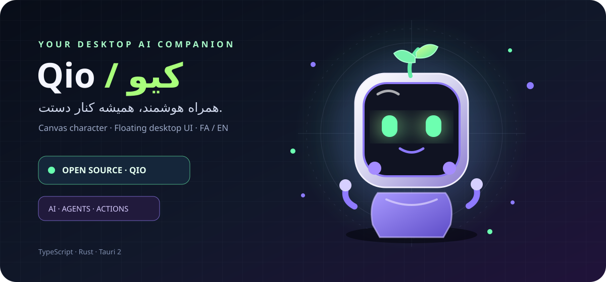

<div align="center">



# ✦ Qio / کیو

### دوست هوشمند دسکتاپت؛ با حال‌وهوای voxel و Minecraft

**کیو یک همراه جمع‌وجور برای کار با ابزارهای هوش مصنوعی و برنامه‌نویسی است.**  
با کاراکتر مکعبی، رابط فارسی و انگلیسی، حالت‌های واکنشی و راهنماهای اتصال، همیشه گوشهٔ دسکتاپت جا دارد. 🟩

[](https://github.com/sahandse/Qio/releases/latest)
[](https://github.com/sahandse/Qio/actions/workflows/ui-check.yml)
[](https://github.com/sahandse/Qio/releases/latest)
[](https://github.com/sahandse/Qio/actions/workflows/macos-release.yml)
[](#-زبانها--languages)

[⬇️ دانلود نسخه دسکتاپ](https://github.com/sahandse/Qio/releases/latest) · [📘 راهنمای اتصال AI](docs/AI_PROVIDERS_FA.md) · [🧩 راه‌اندازی Agentها](docs/DESKTOP_SETUP_FA.md) · [🌐 English setup](docs/DESKTOP_SETUP_EN.md) · [🗺️ نقشه راه](docs/ROADMAP_FA.md) · [💬 پشتیبانی](https://t.me/sahandse)

</div>

---

## 🧊 ظاهر تازهٔ کیو

- **کاراکتر voxel** با حال‌وهوای بازی‌های بلوکی، روی پس‌زمینهٔ تیره و جزئیات نئونی.
- **فارسی و English** با جهت درست متن (RTL/LTR).
- پنجرهٔ شناور و بدون قاب، حالت کوچک و بزرگ و دسترسی از System Tray.
- واکنش‌های بصری و اعلان‌های اختیاری؛ حرکت‌ها را می‌توان محدود کرد.
- نمایش وضعیت‌ها باید بر پایهٔ نتیجهٔ واقعی باشد؛ صرف نمایش یک Agent یا تاریخچه به معنی آنلاین‌بودن آن نیست.

## 🚀 دانلود و نصب

| سیستم‌عامل | دریافت | وضعیت |
|---|---|---|
| 🪟 **Windows 10/11** | [نصب‌کننده EXE و MSI](https://github.com/sahandse/Qio/releases/latest) | نسخهٔ منتشرشده را در Latest Release بررسی کنید |
| 🍎 **macOS** | [DMGهای Intel و Apple Silicon](https://github.com/sahandse/Qio/releases/latest) | فقط پس از موفقیت ساخت و انتشار؛ امضا و notarization فعلاً تضمین نشده |
| 🐧 **Linux** | [راهنمای اجرا از سورس](docs/INSTALL_LINUX_FA.md) | آزمایشی |
| 📱 **Android / iOS** | — | نسخهٔ قابل نصب منتشر نشده |

صفحهٔ [Latest Release](https://github.com/sahandse/Qio/releases/latest) را باز کن و فایل‌های همان نسخه را از بخش **Assets** بگیر. هش نصب‌کننده‌های ویندوز در `SHA256SUMS.txt` و هش فایل‌های macOS در فایل‌های `SHA256SUMS-macOS-*.txt` قرار می‌گیرد. DMGهای مک تا زمانی که ساخت هر دو معماری موفق و فایل‌ها به Release متصل نشده باشند، منتشرشده محسوب نمی‌شوند.

## ✨ امکانات

<details>
<summary><strong>🧑‍💻 همراه برنامه‌نویسی و Agentها</strong></summary>

- نمایش رویدادهای محلی و تاریخچهٔ نشست‌ها در موارد پشتیبانی‌شده.
- راهنمای اتصال برای ابزارهایی مثل **Cursor، Claude Code و Qoder**.
- اسکریپت نصب Hook برای Cursor: `npm run setup:cursor` (تنظیمات قبلی حفظ و پشتیبان‌گیری می‌شود)
- اسکریپت نصب Hook برای Qoder: `npm run setup:qoder`
- اسکریپت اتصال Claude Code: `npm run setup:claude`
- وضعیت تاریخچه، Hook و اتصال زنده با هم یکی نیستند؛ هر کدام فقط وقتی گزارش می‌شوند که دادهٔ مربوط به همان مورد موجود باشد.
- درخواست‌های Permission خودکار تأیید نمی‌شوند؛ تصمیم نهایی با کاربر است.

</details>

<details>
<summary><strong>🤖 گفت‌وگوی مستقیم با ارائه‌دهندگان AI</strong></summary>

اتصال‌های تعریف‌شده در سورس شامل این سرویس‌ها هستند:

- **ایرانی:** AvalAI، Hooshgar
- **ابری:** OpenAI، Gemini، OpenRouter، DeepSeek، Groq، Together AI، Mistral AI، xAI Grok، Fireworks AI، Cerebras، Perplexity، SambaNova، NVIDIA NIM، SiliconFlow، Hugging Face، GitHub Models، Cohere و Novita AI
- **محلی:** Ollama و LM Studio

برای سرویس ابری، کلید API معتبر و مدل قابل استفاده لازم است. برای Ollama یا LM Studio نیز باید سرور و مدل روی سیستم خودت اجرا باشند. وجود نام سرویس در فهرست به معنی تأیید اتصال یا دسترسی حساب نیست.

راهنما: [ارائه‌دهندگان و تنظیمات API](docs/AI_PROVIDERS_FA.md)

</details>

<details>
<summary><strong>🎛️ تجربهٔ دسکتاپ</strong></summary>

- پنجرهٔ بدون قاب و همیشه‌روی‌صفحه
- حالت کوچک و بزرگ، System Tray و اعلان‌های اختیاری
- تم‌های نیمه‌شب، روشن، زمردی و بنفش؛ تغییر اندازهٔ کاراکتر و کاهش حرکت
- پاک‌کردن جداگانهٔ تاریخچهٔ Hookهای محلی از داخل داشبورد
- گزینه‌های شخصی‌سازی و کاهش حرکت
- رابط فارسی و انگلیسی
- راهنمای نصب و عیب‌یابی

</details>

## 🌐 زبان‌ها / Languages

- **فارسی:** رابط راست‌چین و راهنماهای فارسی.
- **English:** رابط چپ‌چین و محتوای دوزبانه در حال تکمیل است.

از کلید زبان داخل برنامه استفاده کن. اگر بخشی هنوز ترجمه نشده بود، آن بخش را ناقص در نظر بگیر و گزارش بده.

## 🧭 نقشه راه و گزارش مشکل

نقشه راه دوزبانه در [فارسی](docs/ROADMAP_FA.md) و [English](docs/ROADMAP_EN.md) قرار دارد. برای گزارش باگ یا پیشنهاد، از قالب‌های بخش [Issues](https://github.com/sahandse/Qio/issues/new/choose) استفاده کن تا نسخه، سیستم‌عامل و مراحل بازتولید مشخص باشند.

## 🛠️ اجرا از سورس

پیش‌نیازها: Node.js 22، Rust و پیش‌نیازهای [Tauri 2](https://v2.tauri.app/start/prerequisites/).

```bash
git clone https://github.com/sahandse/Qio.git
cd Qio
npm install
npm test
npm run tauri dev
```

ساخت بسته روی سیستم سازگار:

```bash
npm run tauri build
```

برای تست واقعی یک دستور دلخواه، آن را از مسیر پروژه و با اسکریپت مناسب اجرا کن؛ موفقیت تست‌های خود Qio به معنی تست‌شدن همهٔ ابزارها یا سرویس‌های خارجی نیست.

## 🔐 امنیت و شفافیت

- کلیدهای API را در README، Issue یا اسکرین‌شات منتشر نکن؛ آن‌ها را طبق راهنمای ارائه‌دهنده در متغیرهای محیطی تنظیم کن.
- Hookهای Qio برای رویدادهای پشتیبانی‌شده طراحی شده‌اند؛ متن کامل مکالمه یا محتوای فایل‌ها نباید به‌عنوان وضعیت اتصال فرض شود.
- اجازهٔ اجرای ابزارها به‌صورت خودکار پذیرفته نمی‌شود.
- اتصال واقعی، سازگاری هر Agent و نتیجهٔ درخواست API فقط با بررسی همان اجرا مشخص می‌شود.

## 🐛 مشکل داری یا ایده‌ای داری؟

[ثبت مشکل در GitHub](https://github.com/sahandse/Qio/issues) · [وضعیت توسعه](docs/STATUS.md) · [تلگرام @sahandse](https://t.me/sahandse)

<div align="center">

**Qio — کوچولو، بلوکی و همیشه همراه. 💜🟩**

<sub>TypeScript · Rust · Tauri 2 · نسخهٔ تنظیم‌شده در سورس: v0.1.6؛ انتشار نصب‌کننده‌ها فقط پس از موفقیت CI تأیید می‌شود.</sub>

</div>

---

## English

**Qio is a compact desktop AI companion** with a voxel-inspired character, Persian/English interface, a floating window, optional notifications, and setup guides for supported coding-agent workflows.

- **Download:** [Latest Windows and macOS release assets](https://github.com/sahandse/Qio/releases/latest)
- **AI providers:** [Provider and API guide](docs/AI_PROVIDERS_FA.md) — includes native Claude/Anthropic Messages API support.
- **Agent setup:** [Desktop setup guide](docs/DESKTOP_SETUP_FA.md)
- **Build status:** [GitHub Actions](https://github.com/sahandse/Qio/actions/workflows/ui-check.yml)
- **Issues and feedback:** [Open an issue](https://github.com/sahandse/Qio/issues)

Qio distinguishes local history, hook events, and live API connectivity. Activity can be searched and filtered by agent; local metadata logging can be disabled in Settings. A listed provider or detected history does not by itself mean a service is currently connected. macOS DMGs are not signed or notarized unless a future release explicitly confirms that.
